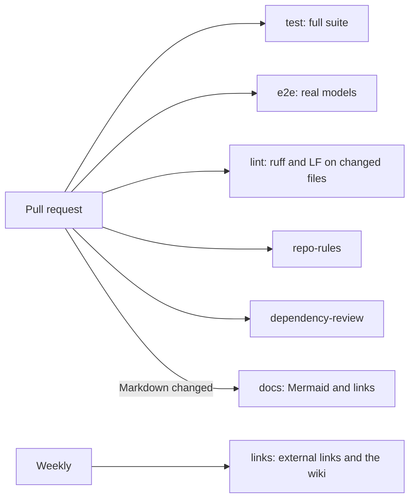

# Contributing to StrataKB

Thanks for your interest! Bug reports, ideas and pull requests are welcome. Good first stops are the open [enhancement issues](https://github.com/boudou/StrataKB/issues?q=is%3Aissue+is%3Aopen+label%3Aenhancement), the [milestones](https://github.com/boudou/StrataKB/milestones), and the product goal in [docs/IMPROVEMENTS.md](docs/IMPROVEMENTS.md).

## Setup

```bash
uv sync --extra dev
cp .env.example .env          # optional local settings
export STRATAKB_CONFIG=.env   # ./.env is read only through this
docker compose up -d       # PostgreSQL + pgvector for the integration tests
```

Python 3.12+ and [uv](https://docs.astral.sh/uv/) are required.

## Before opening a pull request

- Run `uv run pytest`. With the database running, every test must pass.
- Run `uv run ruff check` on the files you changed and leave them cleaner than you found them.
- Keep changes focused; one topic per pull request.
- Match the surrounding code: naming, comment density, idiom.
- Docs come in two parts. The Quick start at the top of the README (and the wiki's Home page) gets a developer from nothing to a first answer in plain words, with no retrieval terms such as chunks, embeddings or top_k. Everything below it is the reference, and the terms it uses are explained in its Glossary. Say in the pull request which part your change touches, and add a Glossary entry for any new term.
- Keep the code domain-neutral. Anything specific to one documentation domain belongs in a layer preset under `examples/`, not in `src/`.
- Name new MCP tools `strata_<verb>_<noun>`, guard them with `@require_role`, and write an audit entry for anything that changes data.
- Log with structlog only. Logs go to stderr; stdout carries the MCP protocol.
- Never log secrets or personal data; the masking in `core/logging.py` is a safety net, not a licence.

## Repository rules

The repository is public, so commits, pull requests and docs follow three rules:

- No attribution trailers from tools or bots: no `Co-authored-by:` line for a bot or a `noreply@` service address (Dependabot's own pull requests excepted), and no "Generated with" or "Generated by" lines. Credit people, not tools.
- No absolute paths into your home folder (`C:\Users\<you>\…`, `/home/<you>/…`, `/Users/<you>/…`). Write paths relative to the repository, or use a placeholder.
- No personal data or names of private projects.

The `repo-rules` check enforces the first two on every pull request, reading the commit messages, the title and description, and the lines you add. Run it locally before you push:

```bash
python scripts/check_repo_rules.py origin/main
```

## What CI checks



- **test:** `uv run pytest` against an empty Postgres that the server's migrations build, as on a new install. It includes a stdio smoke test that starts `python -m stratakb` and checks that stdout carries only JSON-RPC.
- **e2e:** embeds eight PEPs with the real embedding and reranking models and asks `strata_search` and `strata_ask` about them. Locally: `STRATA_E2E=1 uv run pytest tests/test_e2e_real_model.py` with the PEPs fetched (see `examples/README.md`) and the database up. The first run downloads the models.
- **lint:** `ruff check` on the Python files you changed, and LF line endings on every file you changed.
- **dependency-review:** fails when a pull request adds or bumps a dependency with a known high-severity vulnerability.
- **docs:** renders every Mermaid diagram (`npx @mermaid-js/mermaid-cli -i README.md -o out.md`) and checks relative links and anchors between the repository's files ([lychee](https://lychee.cli.rs/) with `--offline --include-fragments`).
- **links (weekly):** external links in the repository and the wiki. It only reports.

## Reporting bugs

Open an issue with the steps to reproduce, what you expected, what happened, your OS, and your MCP client. For ingestion problems, a minimal sample file helps most.

## License

By contributing you agree that your contributions are licensed under the [MIT License](LICENSE).
