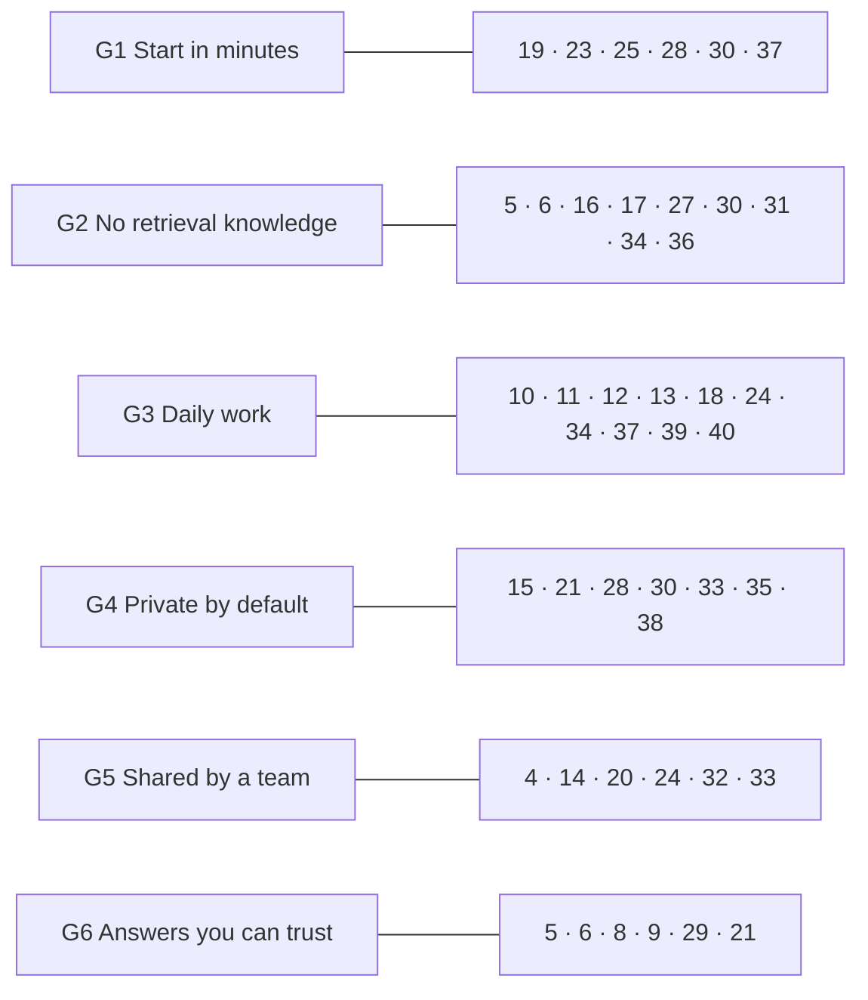
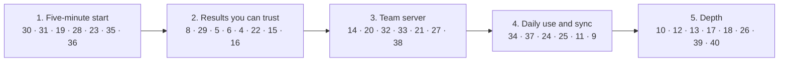

# Improvements and roadmap

Known issues and planned work, most important first. Each item says what is wrong or missing, why it matters, and where to start. Remove an item once it ships, and note it in the [changelog](../CHANGELOG.md). Item numbers never change, so references to them stay valid.

Priorities: **V** gaps in the product goal · **P0** correctness or security · **P1** retrieval quality and MCP compliance · **P2** features and polish.

Sources are listed at the end.

---

## Product goal

StrataKB lets a developer, or a team of developers, turn their own documents into a knowledge base their tools can ask, without learning how retrieval works and without sending private data anywhere they did not choose. Every item below must serve at least one of these goals:

| Goal | What the developer sees |
| --- | --- |
| **G1 Start in minutes** | One command for one person, no Docker; a short, standard path to a team server. |
| **G2 No retrieval knowledge needed** | No chunk sizes, regular expressions, `top_k` or raw scores in the normal path. Defaults that work; advanced settings stay available. |
| **G3 Fits daily work** | Works from the MCP client, the terminal and scripts; ingests repositories and docs folders; every answer links back to its source. |
| **G4 Private by default** | Nothing leaves the machine or the team server unless configured, and the docs say exactly what goes where. Private layers stay private inside a team. |
| **G5 Shared by a team** | One server, real identities, roles, audit, and sources that stay in sync. |
| **G6 Answers you can trust** | Measured quality, and an honest "not found" instead of a confident wrong answer. |

### How the items map to the goals

Items 22 (server version) and 26 (developer experience) support the others and serve no goal directly.

Changes of direction the goal requires in existing items:
- **11:** cloud OCR and the vision model for figures send document content out. They are opt-in and blocked by the local-only switch (item 35).
- **12 and 13:** per-layer regular expressions are an advanced option. A layer must work without them, and presets ship the patterns for their domain.
- **20:** a team server also needs ingestion from the developer's machine (item 32) and per-layer access (item 33). Otherwise every developer still needs shell access to the server.
- **23:** `init` runs `stratakb add` (item 30), so it asks nothing about layers or chunking.
- **24:** git repositories come first among connectors, since that is where developers keep READMEs, ADRs, runbooks and API specs.

### Order of work

Item numbers never change, so the order is kept here.

- Milestone 1 comes first because nobody reaches the other features without it. Items 6 and 29 are small and can ship alongside it.
- Item 8 opens milestone 2: items 5, 29 and the fusion weights cannot be tuned without its numbers.
- Item 14 comes before item 20, because the SDK 2.x line brings the auth support.
- Item 28 comes before item 23, so the local mode can install without the 400 MB in-process model.

---

## V: gaps in the product goal

### 30. Add a folder in one step

Today a developer creates a layer (name, display name, `chunk_config`, `routing_patterns`) and then ingests a server path in a second call (`knowledge/tools.py:66`, `:167`), or writes a preset. Both ask for retrieval decisions the developer should not have to make (G1, G2).

- **One command, `stratakb add ./docs`.** It adds no MCP tool: agents with a shell run the command, and agents without one keep `strata_ingest_documents`. It creates the layer if needed, named after the folder, and ingests it. One layer holds one folder. A moved folder is deleted and added again.
- **File selection.** Inside a git working tree the file list is what git lists. Outside git it is a built-in skip list plus the root `.gitignore`. A `.strataignore` narrows both. Code, build files and lockfiles are skipped and counted. `.txt`, `.rst` and `.adoc` join the supported formats.
- **Secrets.** Files whose names look like secrets are skipped on every ingest route, including MCP and presets, and no flag overrides this. Names are matched, not content (item 38).
- **No retrieval settings.** The description is the folder's README or first heading. Chunking uses the layer default and is never shown; per-format tuning waits for item 8.
- **Report.** A plain-text report says what was added, updated, unchanged, removed, skipped, flagged or failed, and why. `--json` and fixed exit codes (0, 1, 2, 3, 130) serve agents and CI. Empty files count as "no text", not as failures. Scanned PDFs are ingested for whatever text they have and flagged (item 11).
- **Re-runs.** Running it again uses the per-file sync of `ingest_documents`: unchanged files are skipped without loading the model, and removed or newly excluded files are dropped. It asks before a broad path or a large run, and refuses when nobody is at the terminal.
- **Records.** It records the layer's owner, origin and root folder (so item 33 needs no data migration) and writes an audit entry.
- **Config and freshness.** The CLI and the server read the same config: environment, then `STRATAKB_CONFIG`, then a user-level `config.env`. The `.env` in the current folder is no longer read. A running server sees new content within about 2 seconds.
- **Design:** `docs/designs/add-folder.md`, with decisions in `add-folder-decisions.md`.

### 31. Routing without regular expressions

Layer routing needs per-layer regular expressions (`layer_detect.py`). A layer without them is found only through learned affinities, which start empty. Developers should not have to write regular expressions to get routing (G2).

- Route by meaning: embed each layer's description (and optionally the centroid of its chunks) and score the question against them. Patterns from presets and learned affinities still add to the score.
- With a single layer, or when no layer stands out, search all layers. Item 6 covers the fallback when routing guesses wrong.
- Measure routing accuracy with item 8 before making it the default.

### 32. Ingest from the developer's machine

`strata_ingest_documents` and presets read a path on the server's disk. On a shared team server (item 20) that path is not the developer's, so only someone with shell access to the server can add documents (G5).

- A command, `stratakb push ./docs --layer team-docs --server https://…`, that sends the files over the authenticated API. The server parses, chunks and embeds them.
- Size and type limits, and the same skipped-file report as item 30.
- Uploads are audited with the uploader's identity.

### 33. Per-layer access

Roles are global: every viewer can search every layer. A team that shares one server cannot keep one group's documents away from another (G4, G5).

- Each layer gets an owner and a visibility: everyone, listed groups, or the owner only.
- Search, ask, listing, resources and learning data honour it. A hidden layer's chunks, names and affinities never reach a user without access, and the query cache is keyed by the user's set of allowed layers.
- The read-only SQL tools must honour it too, for example through row-level security on `strata_vectors.chunks`. Otherwise an operator can read hidden chunks with a query.
- Ship it in the same release as item 20, not before. On stdio the identity is `STRATA_USER`, which each user sets, and every user holds the database credentials, so per-layer checks before item 20 would only look like security.
- Until then, a group whose documents must stay separate gets its own database.

### 34. Answers a developer can act on

Results carry scores, chunk ids and internal metadata, and the source is a bare file name. A developer wants the source, a way to open it, and an honest signal when nothing relevant was found (G2, G3).

- Every citation has the file's relative path, the section, the page or line range when known, and a link: a resource link (item 18) or, for connector sources, the URL or the repository path at the commit.
- The default response gives the passage and its citation. Scores and metadata move to `response_format: "detailed"` (item 17).
- Confidence is reported as "found", "partly found" or "not found", with a next step for the last two, such as "no layer covers this; add a folder with `stratakb add`". This depends on calibrated scores (item 5).

### 35. Say where data goes, and a local-only switch

Data can leave the machine in four ways today:
- retrieved chunks go to the client's language model, which is often a cloud service;
- with an Anthropic key set, questions go to Anthropic for query rewriting (`rag/query_rewriter.py`);
- with the `openai` backend, documents and questions go to OpenAI for embedding;
- the planned cloud OCR and figure descriptions (item 11) would send documents out too.

The docs do not say this in one place (G4).

- A README and wiki section, "Where your data goes", with a diagram of each path and the setting that controls it.
- `STRATA_LOCAL_ONLY=true` refuses to start with any outbound provider configured, and the error names the setting that caused it. The switch is off by default, because the defaults are already local: query rewriting needs an Anthropic key, and OpenAI embeddings need the `openai` backend. It is a guarantee an admin opts into.
- The switch also covers model downloads. It runs the Hugging Face libraries offline (`HF_HUB_OFFLINE=1`) and fails with a clear message when the embedding or reranker model is not installed locally.
- `strata_admin_health` always lists the active outbound providers, whether the switch is on or not.
- State plainly that StrataKB cannot control what the client's model does with retrieved text, and point to local models (item 28) for teams that need that guarantee.

### 36. Docs in two tiers

The README and wiki explain features with retrieval terms (chunks, HNSW, RRF, `top_k`, confidence thresholds). A first-time developer needs none of them (G2).

- **Tier 1, the quick start:** a five-minute page with install, add a folder, connect a client and ask, written without retrieval terms. It is the top of the README and the wiki's Home page.
- **Tier 2, how it works:** the current material, with a short glossary for the terms it keeps.
- A check during review: any user-visible change says which tier it touches.

### 37. A command line for daily use

Everything goes through an MCP client today. Developers also work in terminals, scripts and CI (G3).

- `stratakb ask`, `stratakb search`, `stratakb push` (item 32) and `stratakb status`, against the local mode (item 23) or a team server (item 20). `stratakb add` and the `stratakb` entry point come with item 30.
- Layer edits: `stratakb describe <layer>` to change a description, and deleting a layer.
- `stratakb add --rebuild`, once item 24 or real use shows that people rebuild often. Until then, `strata_ingest_documents(replace_all=True)` or delete and re-add covers it.
- Plain text by default, `--json` for scripts.
- They reuse the tool functions, so the CLI and the MCP tools cannot drift apart.

---

## P0: correctness and security

### 4. Filtered vector search may skip the HNSW index

When layers are given or auto-detected, the semantic CTE adds `WHERE layer_name IN (…)` before `ORDER BY embedding <=> $1` (`rag/retriever.py:239`). PostgreSQL can then build candidates from the `layer_name` b-tree and sort exactly, which is a brute-force scan on a large layer, and queries can time out at around 100k chunks.

**Fix:**
- Check with `EXPLAIN ANALYZE` on a large layer.
- If the index is skipped, choose between:
  - pgvector 0.8's iterative index scans (`SET LOCAL hnsw.iterative_scan = relaxed_order`);
  - partial HNSW indexes per large layer;
  - a separate query without the `WHERE` clause when no filter applies.

### 5. Confidence levels are not meaningful

`score_confidence` compares scores with fixed thresholds (0.8 high, 0.6 medium). But neither score type behaves like those thresholds assume:
- **Hybrid scores** are divided by the top score (`rag/retriever.py:341`), so the best result always scores 1.0.
- **Reranked scores** are raw cross-encoder logits (`rag/tools.py:312`). They can be negative or above 1.

The result is that "high confidence" mostly reflects how many results came back.

**Fix:** squash logits with a sigmoid, or keep the raw cosine similarity alongside the fused rank. Then calibrate the thresholds on an evaluation set (item 8), including unanswerable questions.

### 6. Automatic narrowing can silently hide results

- **Metadata hints filter instead of boosting.** `extract_metadata_hints` turns words like "guide", "book" or "pdf" into a hard `doc_type` filter (`rag/tools.py:118`). Results from Markdown or HTML then disappear. Make hints a ranking boost, or apply them only when the caller asks.
- **Wrong routing returns little or nothing.** Auto-detected layers restrict the search. If routing guesses wrong, the answer is "nothing found". Fall back to all layers when the routed search returns fewer than `top_k` results or low confidence, and say so in the response.

---

## P1: retrieval quality and evaluation

### 8. An evaluation suite with frozen gold sets

Most items above need numbers before and after a change. Build evals in tiers by cost:

| Tier | Checks | Cost | When |
| --- | --- | --- | --- |
| Component | parsers, chunking invariants, routing patterns, PII scrubbing | free | every PR |
| Retrieval | recall@k, MRR and doc@1 per layer on a frozen query set | embeddings + DB | on demand |
| Known item | identifier lookups, e.g. "AC04" → the reason code chunk | embeddings + DB | on demand |
| Abstention | out-of-corpus questions must come back as low confidence | embeddings + DB | before release |
| Scale | p50/p95 latency and filtered recall at 10k, 100k, 1M chunks | DB | when the store grows |

- **Gold sets.** Generate them synthetically from ingested chunks: an LLM writes a question per chunk, and a second pass rejects garbled, non-self-contained or unanswerable questions. Freeze the result in JSONL, and edit it only to add coverage or fix a wrong label.
- **Reports.** Commit JSON snapshots under `evals/report/` to track trends, and keep a findings log.
- **Tuning.** Use the evals for an RRF-weight ablation; StrataKB's default 0.7/0.3 has never been measured. The keyword leg now ORs every word of the question (`_build_hybrid_sql`, `rag/retriever.py`); measure its recall and cost on long questions with the full hybrid pipeline, and compare `ts_rank` with `ts_rank_cd`. `tests/test_keyword_search.py` only checks the keyword leg on six hand-written chunks.
- **Chunk settings.** Item 30 uses the layer default (1000/200) for every format. Tune per format (Markdown, PDF, specs) once the retrieval tier gives numbers.
- **Settings per layer.** Store the embedding model and chunk settings on each layer, and warn when a later ingest uses different ones. Today a changed model silently mixes two vector spaces in one layer.
- **`stratakb add --verbose`.** Per-file chunk counts and timings, for tuning.

### 9. Full-text search per layer language

The `tsv` column is generated with the `english` configuration (`db/01_init.sql:78`), so documents in other languages get no stemming. Code-heavy layers (XSD, OpenAPI) are better served by `simple`.

**Fix:**
- Add a `text_search_config` per layer.
- Generate `tsv` from it: either an expression index per configuration, or store the configuration in a column.
- Optionally fold accents with the `unaccent` extension. In inflected languages, `simple` can miss almost every match that the language's own configuration finds.

### 38. Scan file content for secrets

Item 30 skips files whose *names* look like secrets (`.env*`, `*.pem`, `id_rsa*` and so on) on every ingest route. A key pasted into `notes.md` or `config.yaml` still goes in (G4).
- Scan text before chunking for known key formats: cloud provider keys, private key blocks, tokens with a fixed prefix, and high-entropy strings next to words such as `password` or `secret`.
- Skip the file and report it as `secret_content`, or redact the match; decide which per route.
- Keep the patterns in one list shared with the PII scrubber, and test them for false positives on the example presets.

### 10. Rerank in `strata_search` too

Only `strata_ask` reranks. Offer `rerank=true` on `strata_search`, the tool used for exact identifiers, so both tools rank the same way.

### 11. Scanned PDFs and layout

pypdf returns nothing for scanned pages and loses table structure.

- **Quality gate.** Item 30 flags a PDF as probably scanned when fewer than half its pages have text, or when it averages under 200 characters per page. It is still ingested, and the report points here. This item adds the OCR that fills the gap.
- **Headings in `.rst` and `.adoc`.** Item 30 parses them as plain text. Split them on their section titles, as Markdown is.
- **OCR fallback chain.** Use local `ocrmypdf` with Tesseract, and optionally a cloud OCR API. The cloud API and the vision model below are opt-in and blocked by the local-only switch (item 35). Cache OCR output keyed by file and modification time, and record the engine used in the chunk metadata.
- **Diagnose command.** Add `stratakb diagnose <file>`, which shows how one file parses and chunks without writing anything.
- **Layout.** Consider Docling for layout-aware PDF and DOCX parsing (headings, tables).
- **Figures.** Diagrams and charts carry no text, so they are lost today. Optionally extract embedded images (pypdf exposes them per page as `page.images`), have a vision model describe each one, and store the description as a chunk with `content_type: figure`, the page number and the image hash in its metadata. Cap the number of images per document, skip small images such as logos and icons, and cache descriptions by image hash so re-ingestion does not pay twice.

### 12. Cross-document references

Questions such as *"which documents reference pacs.008?"* or *"what replaced rulebook v1.0?"* need relations, and similarity search can't answer them reliably. At ingest:
- extract reference candidates with per-layer regex patterns (cheap, run on every chunk);
- optionally classify the relation with a small model;
- store the edges in a `references` table.

Expose the result as a `strata_related` tool. This replaces the unused cross-layer mappings table of the original design.

### 13. Exact-lookup catalogs

Codes, identifiers and reference lists are better served by exact lookup than by embeddings. Generalize this as a preset `catalogs:` section:
- the CSV or JSON is loaded into a lookup table keyed by a chosen column;
- one `strata_lookup(catalog, key)` tool serves all catalogs;
- routing sends identifier-shaped queries there first.

A catalog must work from its key column alone. Identifier patterns are optional and ship with presets (see item 31 for routing without regular expressions). The same applies to item 12's reference patterns.

### 29. Keyword-only matches cannot reach hybrid results

Hybrid search fuses the vector and full-text ranks with weighted RRF (`_fuse_rrf`, `rag/retriever.py`). A leg that misses a chunk adds 0. With the defaults (`hybrid_rrf_k` 60, weights 0.7 and 0.3), a chunk found only by the full-text leg scores at most 0.3/61 ≈ 0.0049. Every vector rank below 82 scores more, and `top_k` is at most 50. So once the vector leg returns `top_k` rows, which it does for any filtered set of that size, no keyword-only chunk is returned. An identifier such as `AC04` in a chunk the embedding misses is still lost.

- **Fix options:** reserve a few result slots for the best keyword-only hits, raise `kw_weight`, or fuse over the union with a per-leg score floor. Choose with item 8 (known-item tier).
- **Signal:** log how many returned chunks came only from the keyword leg. `keyword_results` in `hybrid_search_complete` counts the rows the leg returned, not the rows that reached the results.
- **Timeout:** the hybrid query runs under the pool's 30 s asyncpg `command_timeout` only. Set `SET LOCAL statement_timeout` in `_hybrid_search`, as `database_access/tools.py` does.

---

## P1: MCP compliance and tool design

Checked against the MCP specification revision 2026-07-28 and the MCP Python SDK as of October 2026.

### 14. Migrate to MCP Python SDK 2.x

`pyproject.toml` caps `mcp` below 2 because 2.0 removed `mcp.server.fastmcp`. The 1.x line still gets security fixes, but no new protocol revisions.

**Migration notes:**
- `MCPServer` from `mcp.server.mcpserver` replaces `FastMCP`.
- Transport arguments move to `run()`.
- `MCP_*` environment variables and `.env` files are no longer read by the SDK; StrataKB's own settings are unaffected.
- Plain `def` tools run on a worker thread.
- Raise `ToolError` so the model sees the error.

2.x speaks the stateless 2026-07-28 protocol and still serves older clients. The standalone FastMCP 4.x, which is built on SDK 2.x, is an alternative with built-in auth providers.

### 15. Tool annotations

Declare hints on every tool. The defaults assume the worst (`destructiveHint=true`, `openWorldHint=true`).
- Search, ask, list, status, stats, health and the SQL tools: `readOnlyHint=true, openWorldHint=false`.
- `strata_delete_knowledge_layer`, `strata_reset_learning` and `strata_apply_preset` (it deletes chunks first): `destructiveHint=true`.
- `strata_ingest_documents` and `strata_apply_preset`: set `idempotentHint` accordingly.

### 16. Structured output and real errors

Tools return plain dicts with `{"status": "error", …}`, so failures reach the client as *successful* results. Instead:
- return typed Pydantic models, so the SDK publishes an `outputSchema` and `structuredContent`;
- raise `ToolError` for failures, so the result carries `isError: true`;
- write error messages that say how to fix the call.

Since 2025-11-25, input-validation errors are tool errors too, not protocol errors.

### 17. Fewer, leaner tools and bounded output

21 tools spend the client's context on every session.
- Merge read-only introspection (`strata_db_schema`, `strata_db_vector_stats`, `strata_db_sample_chunks`, `strata_admin_health`) into one or two tools.
- Consider hiding admin tools unless the role allows them; per-request tool lists are allowed.
- Add `response_format: "concise" | "detailed"` to search and ask. Concise returns id, layer, source and a snippet; detailed returns full text and metadata.
- MCP clients cap tool output, so keep the default `top_k` low, truncate long chunks with a hint, and paginate SQL results.
- Front-load keywords in the server `instructions`. Some clients load tool descriptions lazily and show only the instructions and tool names at startup.

### 18. Resources, resource links and prompts

- **Resources:** the layer catalog (`strata://layers`) and source documents (`strata://layers/{layer}/files/{path}`). Search results can then return `resource_link` items that the client opens on demand, instead of repeating full text.
- **Prompts:** expose repeatable workflows as MCP prompts, so the server needs no model of its own and the client's model writes the answer from retrieved chunks. Candidates:
  - output formats over a layer or document: `summary`, `executive_brief`, `faq`, `tutorial`, `explainer`, `compare(a, b)`;
  - shared arguments: `length` (short, medium, long), `audience` or `style` (technical, formal, plain), and free-text `focus`;
  - each prompt tells the client which tool to call first (`strata_search` with the layer, or the document's resource) and to cite sources by chunk id.
- **Progress:** send progress notifications from long ingestions and re-embeds, which keeps clients from timing out.
- **Cancellation:** honour cancelled requests so a long ingestion can be stopped.
- **Elicitation:** ask the user to confirm destructive admin tools, in addition to the `confirm` argument.

### 19. Startup time

The lifespan preloads the embedding model before the server answers (`mcp_server.py:55`). That takes 15–20 s on a cold start and can exceed a client's startup timeout. Answer `tools/list` at once, and load the model in the background or on first use.

### 20. Streamable HTTP for team deployments

The server runs on stdio only. For a shared team server:
- add the Streamable HTTP transport (SSE is deprecated);
- validate `Origin`, and bind to localhost unless deployed behind auth;
- act as an OAuth 2.1 resource server: publish Protected Resource Metadata (RFC 9728), validate the token audience (RFC 8707), and never pass tokens through to other services;
- map viewer, operator and admin to scopes, and answer `insufficient_scope` for step-up;
- take the user identity from the token instead of `STRATA_USER`.

A team server also needs ingestion from the developer's machine (item 32) and per-layer access (item 33).

With several users, two ingests of one layer become likely. Item 30 has no per-layer lock: each file is written in its own transaction, so concurrent runs converge, but layer counts can be briefly wrong. Add a per-layer ingest lock (a PostgreSQL advisory lock keyed by layer) here or with item 24.

### 21. Treat retrieved text as untrusted

Ingested PDFs and web pages can carry prompt-injection text that flows straight to the client. To reduce the risk:
- wrap chunk text in clear delimiters with its source;
- strip control and invisible Unicode characters;
- keep tool descriptions static.

Layer descriptions are admin-written and flow into the query-rewrite prompt, which is acceptable for admins; never let ingested content flow there.

### 22. Report the server version

The server reports the SDK's version (`1.30.0`) as its own. Pass `version=stratakb.__version__` to the server, and keep it in sync with `pyproject.toml`.

---

## P2: features and packaging

### 23. A one-command local mode

Docker and PostgreSQL are the biggest hurdle for a first try.
- **Local backend.** Add a SQLite backend (`sqlite-vec` for vectors, FTS5 for keywords) behind the same retriever interface, for single-user use.
- **Init command.** `uvx stratakb init ./docs` should write the user-level `config.env` that item 30 introduces, run `stratakb add` on the folder and print the MCP client snippet. It asks nothing about layers or chunking.
- **PostgreSQL-only features.** Item 30 relies on an advisory lock in the migration runner, `timestamptz` change stamps and a partial unique index on `root_path`. The SQLite backend needs an equivalent for each.
- **Migration.** Keep PostgreSQL as the team backend, and add `stratakb migrate --to postgres`.

### 24. Incremental sync and connectors

- Watch a folder and re-ingest changed files, using the per-file sync of `ingest_documents` (files are tracked in `strata_core.ingested_files`).
- Add connectors for git repositories (by commit), URLs and sitemaps, and later wikis. Git comes first: it is where developers keep READMEs, ADRs, runbooks and API specs. Citations from a repository link to the file at the commit (item 34).
- A per-layer ingest lock once watching makes concurrent runs common (see item 20).
- Outside git, item 30 applies only the root `.gitignore`. Apply nested `.gitignore` files too, if anyone reports needing it.

### 39. Source-code ingestion

Item 30 skips code files and counts them in the report. Code needs its own splitting (by function and class, with the file path and symbol in the metadata) and its own retrieval checks in item 8 before it joins a layer. Until then, `.strataignore` cannot re-include code, because it is not a supported format.

### 40. Several folders per layer

Item 30 gives each layer one root folder, and a moved folder is deleted and added again. Some teams keep one topic in several folders (`docs/` and `adr/`). Allow several roots per layer, and moving a root without re-embedding unchanged files. This needs a root table instead of `knowledge_layers.root_path`, and a rule for overlapping roots.

### 25. Distribution

- Publish to PyPI so `uvx stratakb` works; the console script already exists.
- Build an MCP bundle (`.mcpb`) for one-click installs in desktop clients.
- Ship a client plugin that bundles the server config with usage instructions.
- If a public listing is wanted later, add a `server.json` for the MCP registry.

### 26. Developer experience

- **Lint.** The code base has 137 ruff findings inherited from the original project. Fix them, then add `uv run ruff check` to CI.
- **Integration tests.** Mark them `@pytest.mark.integration` and skip them when the database is unreachable, so `uv run pytest` passes without Docker.
- **CI install size.** Install CPU-only PyTorch in CI (a `tool.uv` index for `torch`); the default Linux wheel pulls CUDA libraries.
- **Types.** `mypy --strict` is configured but not enforced; type the public functions first.
- **Embedding dimensions.** The `vector(768)` column is shared by all layers, so every layer must use the same model and dimensions. Consider one table per dimension, or per-layer models.
- **Multi-turn questions.** Optionally pass the previous question to the rewriter, so follow-ups ("and for SDD?") become standalone queries.

### 27. Learning loop follow-ups

- **The follow-up signal never fires.** `detect_follow_up` (`learning/signals.py`) looks for entity names in the previous results' `content`, but interactions store only chunk id, score, layer and source file. Store a short excerpt per result (after PII scrubbing), or match against source file and section names instead.
- **Rewrites match exact questions only.** The promoter writes `exact` patterns, keyed by the trimmed, lowercased question. Questions with scrubbed personal data never match their stored form. Consider `keyword` patterns (trigram similarity, already supported by `find_rewrites`) once there is an eval set to check them against (item 8).
- **The promoter runs only every 50 queries, per server process.** Add an admin tool or script to run it on demand, and run it on a schedule for team deployments.

### 28. Any OpenAI-compatible model provider

Embeddings support local sentence-transformers or OpenAI's hosted API, and query rewriting supports Anthropic only (`rag/query_rewriter.py:113`). Many teams run models behind an OpenAI-compatible endpoint instead: Ollama, LM Studio, vLLM, Azure OpenAI, Groq.

- **Embeddings.** Add `EMBEDDING_BASE_URL` and `EMBEDDING_MODEL` to the `openai` backend, so a local Ollama server (`nomic-embed-text`, `mxbai-embed-large`) can replace the 400 MB in-process model. That also removes the model preload from startup (item 19) and gives the local mode (item 23) a light install. Check the model's dimensions against the `vector(768)` column at startup and refuse a mismatch (item 26).
- **Query rewriting.** Add an `openai_compatible` provider with `REWRITE_BASE_URL` and `REWRITE_MODEL`, next to the Anthropic one.
- **Model check.** On startup, list the endpoint's models (`GET /v1/models`) and report a missing model in `strata_admin_health` instead of failing on the first query.
- **Lenient JSON.** The rewriter parses the model's reply with `json.loads` after stripping a leading code fence only (`rag/query_rewriter.py:125`), so a reply with any text around the JSON fails and the rewrite is skipped. Smaller local models do this often. Extract the first JSON array from the reply (inside a fence or not) before parsing, and count parse failures in the logs.

---

## Sources

- MCP specification 2026-07-28, changelog and deprecations: https://modelcontextprotocol.io/specification/latest/changelog
- Tools (annotations, structured content, errors, resource links): https://modelcontextprotocol.io/specification/2026-07-28/server/tools
- Authorization: https://modelcontextprotocol.io/specification/2026-07-28/basic/authorization
- Transports: https://modelcontextprotocol.io/specification/2026-07-28/basic/transports/streamable-http
- Security best practices: https://modelcontextprotocol.io/docs/2026-07-28/tutorials/security/security_best_practices
- MCP Python SDK 2.x migration guide: https://py.sdk.modelcontextprotocol.io/migration/
- MCP bundles: https://github.com/modelcontextprotocol/mcpb
- Writing tools for agents (tool consolidation, response formats): https://www.anthropic.com/engineering/writing-tools-for-agents
- pgvector filtering and iterative index scans: https://github.com/pgvector/pgvector#filtering
