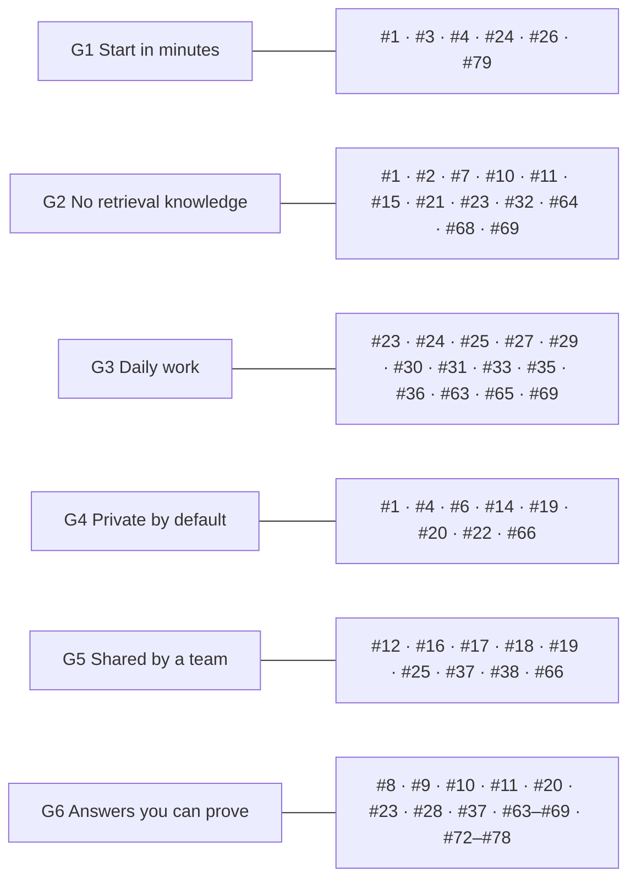
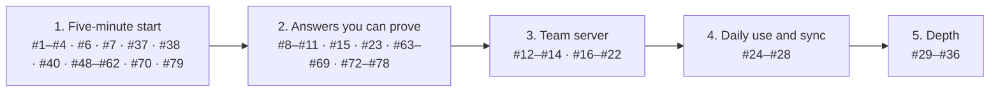
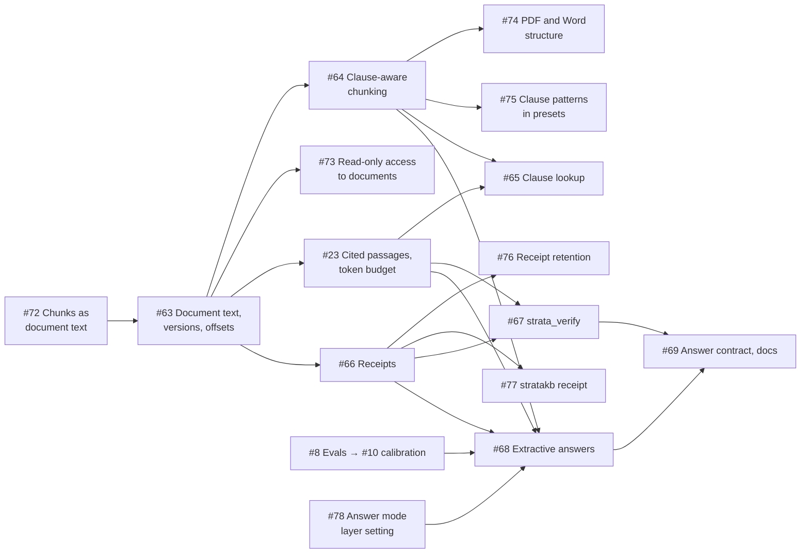

# Product goal and roadmap

Known issues and planned work live in [GitHub issues](https://github.com/boudou/StrataKB/issues), grouped into [milestones](https://github.com/boudou/StrataKB/milestones) and labelled `P0` (correctness or security), `P1` (retrieval quality and MCP compliance), `P2` (features and polish) or `goal-gap`. Issues #1–#36 were the numbered items 4–40 of this file; each says which item it was. This page keeps the goal every issue is checked against and the order of work.

---

## Product goal

StrataKB lets a developer, or a team of developers, turn their own documents into a knowledge base their tools can ask, without learning how retrieval works and without sending private data anywhere they did not choose. Every issue must serve at least one of these goals, and names them on its last line:

| Goal | What the developer sees |
| --- | --- |
| **G1 Start in minutes** | A few commands for one person (`stratakb db up`, `stratakb add`); a short, standard path to a team server. |
| **G2 No retrieval knowledge needed** | No chunk sizes, regular expressions, `top_k` or raw scores in the normal path. Defaults that work; advanced settings stay available. |
| **G3 Fits daily work** | Works from the MCP client, the terminal and scripts; ingests repositories and docs folders; every answer links back to its source. |
| **G4 Private by default** | Nothing leaves the machine or the team server unless configured, and the docs say exactly what goes where. Private layers stay private inside a team. |
| **G5 Shared by a team** | One server, real identities, roles, audit, and sources that stay in sync. |
| **G6 Answers you can prove** | Every claim can be checked against its source: cited passages with exact locations, verified quotes and facts, a receipt to open outside the chat, and an honest "not found" instead of a confident wrong answer. Measured quality. |

### How the issues map to the goals

#13 (server version) and #34 (developer experience) support the others and serve no goal directly.

Changes of direction the goal requires:
- **Milestone 2 (#63–#69, #72–#78):** verifiable answers are the lead promise, for every kind of layer (contracts, rulebooks, specs). The server never asks a model to write the answer: in *grounded* mode the client writes it and `strata_verify` checks every quote and fact; in *extractive* mode the server returns the document's own sentences. Both issue a receipt that a person can open outside the chat. The mode is a layer setting that a question can make stricter, never looser.
- **#27:** cloud OCR and the vision model for figures send document content out. They are opt-in and blocked by the local-only switch (#6).
- **#30 and #31:** per-layer regular expressions are an advanced option. A layer must work without them, and presets ship the patterns for their domain.
- **#17:** a team server also needs ingestion from the developer's machine (#18) and per-layer access (#19). Otherwise every developer still needs shell access to the server.
- **#79:** StrataKB stays on PostgreSQL with pgvector, for one person and for a team. `stratakb db up` starts a local database in Docker; a separate SQLite mode (#5) was dropped.
- **#25:** git repositories come first among connectors, since that is where developers keep READMEs, ADRs, runbooks and API specs.

### Order of work

Each milestone on GitHub holds its issues.

Inside milestone 2:

- Milestone 1 comes first because nobody reaches the other features without it. Shipped so far: #3, #4, #6, #7, #37, #38, #40, #48–#62, #70 and `stratakb db up` (#79); left: the umbrella #1 and #2, and the bug follow-ups. #9 and #11 shipped alongside it.
- Milestone 2 ships `strata_verify` first (#72 → #63 → #23 → #66 → #67): it needs no calibration. #72, #63, #73, #78, #10, #23, #64 and #66 have shipped; #10 put confidence on a meaningful scale with provisional thresholds, and `strata_verify` (#67) and clause lookup (#65) are next. #8 runs alongside, and extractive answers (#68) follow once #8 calibrates the "not found" threshold. #64 and #65 run in parallel. #73–#78 are small slices next to their parents; #78 can start any time, and #77 waits for the `stratakb` command (#70).
- #8 also needs an abstention set and verify-rate and faithfulness metrics for milestone 2.
- #16 comes before #17, because the SDK 2.x line brings the auth support.

---

## Sources

- MCP specification 2026-07-28, changelog and deprecations: https://modelcontextprotocol.io/specification/latest/changelog
- Tools (annotations, structured content, errors, resource links): https://modelcontextprotocol.io/specification/2026-07-28/server/tools
- Authorization: https://modelcontextprotocol.io/specification/2026-07-28/basic/authorization
- Transports: https://modelcontextprotocol.io/specification/2026-07-28/basic/transports/streamable-http
- Security best practices: https://modelcontextprotocol.io/docs/2026-07-28/tutorials/security/security_best_practices
- MCP Python SDK 2.x migration guide: https://py.sdk.modelcontextprotocol.io/migration/
- MCP bundles: https://github.com/modelcontextprotocol/mcpb
- Writing tools for agents (tool consolidation, response formats): https://www.anthropic.com/engineering/writing-tools-for-agents
- pgvector filtering and iterative index scans: https://github.com/pgvector/pgvector#filtering
