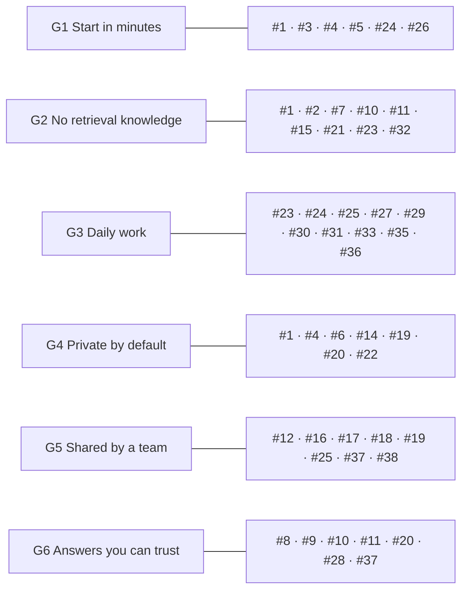
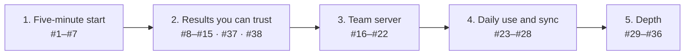

# Product goal and roadmap

Known issues and planned work live in [GitHub issues](https://github.com/boudou/StrataKB/issues), grouped into [milestones](https://github.com/boudou/StrataKB/milestones) and labelled `P0` (correctness or security), `P1` (retrieval quality and MCP compliance), `P2` (features and polish) or `goal-gap`. Issues #1–#36 were the numbered items 4–40 of this file; each says which item it was. This page keeps the goal every issue is checked against and the order of work.

---

## Product goal

StrataKB lets a developer, or a team of developers, turn their own documents into a knowledge base their tools can ask, without learning how retrieval works and without sending private data anywhere they did not choose. Every issue must serve at least one of these goals, and names them on its last line:

| Goal | What the developer sees |
| --- | --- |
| **G1 Start in minutes** | One command for one person, no Docker; a short, standard path to a team server. |
| **G2 No retrieval knowledge needed** | No chunk sizes, regular expressions, `top_k` or raw scores in the normal path. Defaults that work; advanced settings stay available. |
| **G3 Fits daily work** | Works from the MCP client, the terminal and scripts; ingests repositories and docs folders; every answer links back to its source. |
| **G4 Private by default** | Nothing leaves the machine or the team server unless configured, and the docs say exactly what goes where. Private layers stay private inside a team. |
| **G5 Shared by a team** | One server, real identities, roles, audit, and sources that stay in sync. |
| **G6 Answers you can trust** | Measured quality, and an honest "not found" instead of a confident wrong answer. |

### How the issues map to the goals

#13 (server version) and #34 (developer experience) support the others and serve no goal directly.

Changes of direction the goal requires:
- **#27:** cloud OCR and the vision model for figures send document content out. They are opt-in and blocked by the local-only switch (#6).
- **#30 and #31:** per-layer regular expressions are an advanced option. A layer must work without them, and presets ship the patterns for their domain.
- **#17:** a team server also needs ingestion from the developer's machine (#18) and per-layer access (#19). Otherwise every developer still needs shell access to the server.
- **#5:** `init` runs `stratakb add` (#1), so it asks nothing about layers or chunking.
- **#25:** git repositories come first among connectors, since that is where developers keep READMEs, ADRs, runbooks and API specs.

### Order of work

Each milestone on GitHub holds its issues.

- Milestone 1 comes first because nobody reaches the other features without it. #11 and #9 are small and can ship alongside it.
- #8 opens milestone 2: #10, #9 and the fusion weights cannot be tuned without its numbers.
- #16 comes before #17, because the SDK 2.x line brings the auth support.
- #4 comes before #5, so the local mode can install without the 400 MB in-process model.

---

## Sources

- MCP specification 2026-07-28, changelog and deprecations: https://modelcontextprotocol.io/specification/latest/changelog
- Tools (annotations, structured content, errors, resource links): https://modelcontextprotocol.io/specification/2026-07-28/server/tools
- Authorization: https://modelcontextprotocol.io/specification/2026-07-28/basic/authorization
- Transports: https://modelcontextprotocol.io/specification/2026-07-28/basic/transports/streamable-http
- Security best practices: https://modelcontextprotocol.io/docs/2026-07-28/tutorials/security/security_best_practices
- MCP Python SDK 2.x migration guide: https://py.sdk.modelcontextprotocol.io/migration/
- MCP bundles: https://github.com/modelcontextprotocol/mcpb
- Writing tools for agents (tool consolidation, response formats): https://www.anthropic.com/engineering/writing-tools-for-agents
- pgvector filtering and iterative index scans: https://github.com/pgvector/pgvector#filtering
